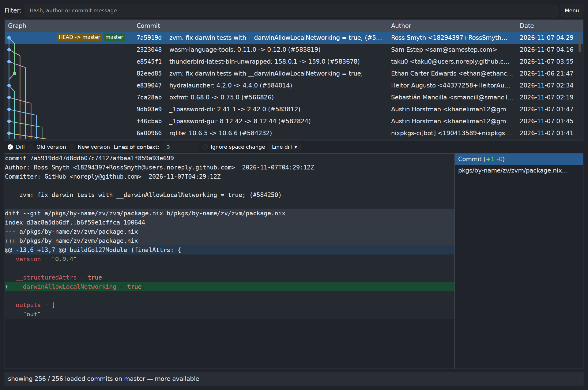

# gitk-rs


A lightweight Git history explorer for Linux and macOS, written in Rust with
[GPUI](https://gpui.rs/).



## Features

- Commit history with a branch graph, author and date columns
- Background loading and filtering to browse large repositories
- Syntax-highlighted diffs with support for more than 200 languages
- Diff, old/new sides, adjustable context, whitespace filtering and word diffs
- File list to jump between changes, with text selection and copying
- Staged, unstaged and untracked changes
- Branch switching, automatic refresh and keyboard navigation
- Light and dark themes with searchable font selection and live previews
- Built to browse large Git repositories such as
  [NixOS/nixpkgs](https://github.com/NixOS/nixpkgs/)
  +  It streams commit history in the background, shows rows as they arrive,
     and virtualizes history and diff rendering so drawing work stays focused
     on what’s visible.

## Usage

Requires Git and either Linux with a Vulkan-capable graphics driver or macOS
with Metal support.

```sh
# Browse the current repository
./gitk-rs

# Browse another repository
./gitk-rs ~/Projects/nixpkgs
```

Press F1 or ? to show all shortcuts.

History streams in the background until the whole repository history is loaded.
For lower memory use, `--limit N` opts into loading history on demand in batches
of N commits.

For more command-line options:

```sh
./gitk-rs --help
```

Preferences are saved as `gitk-rs/preferences.toml` in the OS configuration
directory (`~/.config` on Linux or `~/Library/Application Support` on macOS).
For example:

```toml
# Default options in Linux
ui_font = "DejaVu Sans"
fixed_font = "DejaVu Sans Mono"
font_size = 13.0
theme = "dark"
graph_columns = 256
text_graph = false
syntax = true
watch = true
# batch = 1000 # Omit to stream all history.
```

## Development

### Building

Install a current stable Rust toolchain with [rustup](https://rustup.rs/). On
Ubuntu 26.04, install the native dependencies:

```sh
sudo apt-get update
sudo apt-get install -y build-essential pkg-config cmake clang libclang-dev git \
  libfontconfig1-dev libfreetype6-dev libssl-dev zlib1g-dev libwayland-dev \
  libxcb1-dev libxkbcommon-x11-dev libx11-dev libxcursor-dev libxi-dev \
  libxrandr-dev libvulkan-dev fonts-dejavu-core
```

On macOS, install the Xcode Command Line Tools and build tools with
[Homebrew](https://brew.sh/):

```sh
xcode-select --install
brew install cmake pkg-config
```

Then build and run on either platform:

```sh
cargo build --release --locked
./target/release/gitk-rs /path/to/repository
```

#### Nix

Assuming that you have [Flakes](https://wiki.nixos.org/wiki/Flakes) enabled:

```sh
nix build
./result/bin/gitk-rs /path/to/repository
```

### Checks

With the dependencies above installed, or after entering `nix develop`:

```sh
cargo fmt --all -- --check
cargo clippy --all-targets --locked -- -D warnings
cargo test --all-targets --locked
```

Run `nix flake check` for Rust and Nix formatting, Clippy, Ruff linting and
formatting, and Python script tests. Run `nix build` to build the package and
run its Rust tests.

For the optional GUI test in an isolated NixOS VM with IceWM, run
`nix build .#gui-smoke --print-build-logs` on a Linux builder with KVM. See
[the smoke test instructions](scripts/README.md) for requirements and artifacts.

## License

[MIT](LICENSE).
