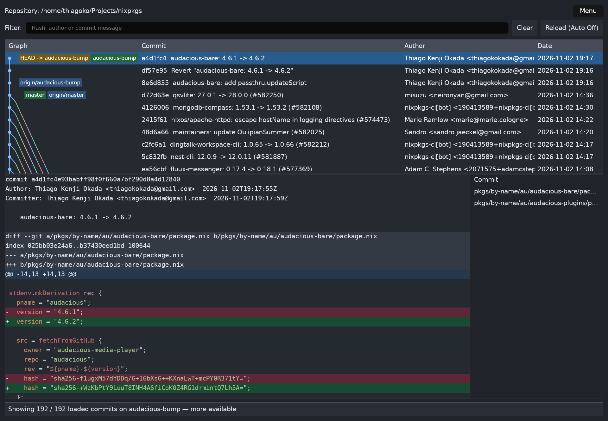
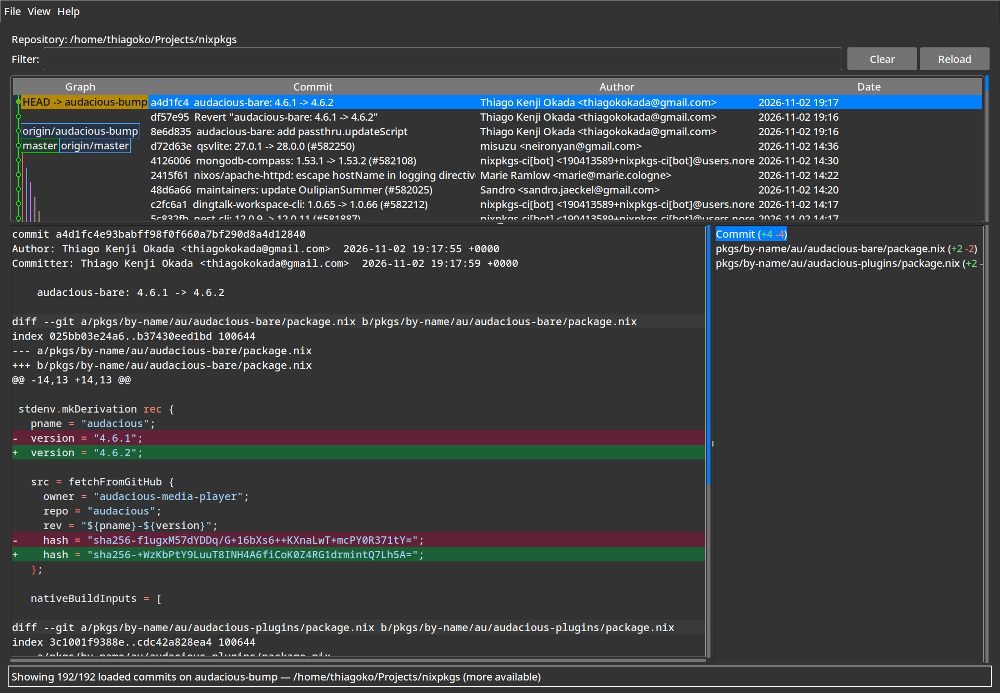

# Linux v0.1 validation

The Linux functionality is implemented. This records checks and their limits;
macOS and native aarch64 execution have not been validated.

## Regression test layers

| Layer | What it protects | Routine command |
| --- | --- | --- |
| Library tests | CLI/parsers, graph/selection geometry, syntax detection/state, plus module-level Git/paging/cancellation fixtures | `cargo test --lib --locked` |
| [Public-service integration](../tests/workflows.rs) | Real Git + asynchronous history/diff/workspace workers, streaming demand, filtering, generations, highlighting, cross-page copying, protected switching and repository-root paths | `cargo test --test workflows --locked` |
| [GPUI integration](../src/ui/tests.rs) and [diff view](../src/ui/diff_view/tests.rs) | Actual views and production key bindings on GPUI test platform; navigation/filter focus, protected branch switching and selection preservation, repository dialog, file clicking and full-diff clipboard | `cargo test --bin gitk-rs --locked` |
| [Native desktop smoke](../scripts/gui_smoke.py) | Real window/backend, dialogs, themes/preferences and repository switching | Optional X11 smoke command below |

`cargo test --all-targets --locked` discovers all Rust targets automatically.
GPUI tests use its test-support feature, simulated input/clipboard and virtual UI
timers, plus bounded waits for real Git worker threads. They need no Python,
xdotool, display server or GPU. Native desktop smoke requires a real display and
is reported separately, rather than implied by a passing headless suite. GPUI uses
a mock platform/text system here: these are view/layout/event/state tests, not
pixel snapshots or validation of native font rasterization. New behavior bugs get
a regression at the lowest useful layer, plus integration/GUI coverage when the
failure crosses those boundaries.

For example, the tab regression compares horizontal extent against expanded text;
the GUI branch regression asserts the selected commit ID after switching. A public
integration test for opening a subdirectory first reproduced missing root-level
untracked files, then passed after diff commands were anchored at the repository
root. These tests assert behavior and observable results rather than source shape.

## Functional evidence

- Formatting, Clippy with warnings denied, 38 library tests and 4 public-service
  integration workflows and 4 GPUI integration tests pass (46 Rust tests total),
  including a run with DISPLAY and WAYLAND_DISPLAY unset.
- Fixtures cover streamed records and cancellation (including Git helpers), graph
  merges/overflow, filtering, annotated tags, detached/unborn/shallow repositories,
  linked worktrees, root/first-parent diffs, binary/renamed/unusual paths, long
  Unicode lines, copying across unloaded lines, stale selections, unmerged status,
  protected branch switching, watcher bursts/manual fallback and preferences.
- Broad highlighting tests check seventeen language families; the actual offline
  bundle contains [213 syntaxes](LANGUAGES.md). Nix/Rust/Go are also reviewed in
  actual viewer screenshots.
- The [GUI smoke script](../scripts/gui_smoke.py) uses disposable repositories and
  isolated preferences. It verifies local rows, rejected/successful branch
  switches, branch filtering, help, preferences, themes, filter editing, reload,
  opening another repository and graceful X11 close. It refuses to send keyboard
  input after its own window loses focus. Artifacts remain in its output directory.
- Installed binaries are tested outside nix develop on Wayland and X11. Startup
  smoke checks keep each backend running for eight seconds; they do not establish
  full interaction coverage on Wayland.
- Both panes and the diff/file split resize. Wide canvas graphs share one spacing
  across visible rows so their lanes fit and adjoining edges stay aligned. The
  text fallback keeps the current node and continuation markers visible.

Native file-picker selection, pointer-driven menu/resize interactions
and Wayland input are not fully automated. KWin/Xwayland ignored pointer-warp
requests during these tests; native XTest keyboard input works. File-list clicks are additionally driven directly through GPUI in Rust. File-range
parsing, strict jump positioning, text selection and keyboard scrolling are checked; no
successful automated pointer-warp test is claimed. The verified path-entry dialog
works independently of the desktop picker.

## Screenshot comparison

Both screenshots use Linux/X11, a dark theme, the same nixpkgs HEAD and 192 loaded
commits, at 1920 x 1332 native pixels. Default toolkit font metrics and pane sizes
vary. The repository/filter toolbar, upper graph/commit/author/date table, lower
highlighted diff and file list, and status bar preserve the original arrangement.
The Rust panes can be resized and its fonts/themes can be changed.

| Rust / GPUI | Go / Tk reference |
| --- | --- |
|  |  |

The original repository's screenshot was also reviewed during planning. The
screenshots above were captured from the test applications' own windows.

## Short nixpkgs observations

These are two eight-second smoke observations per application, not a statistical
benchmark or a million-commit retention test. Functionality is the v1 priority.

- Host: x86_64 NixOS, Linux 6.18.55; AMD Ryzen 5 7600X, 12 logical CPUs;
  MemTotal 31,898,248 KiB. Available GPUs include Radeon RX 9070-series and Radeon
  610M; the Vulkan adapter used was not separately identified.
- nixpkgs: a4d1fc4e93babff98f0f660a7bf290d8a4d12840.
- Go source: fc472ac7040d6982daa123c3577e684a198ad9b4, unchanged. Built through its
  flake using the Rust project's nixpkgs pin, with --no-write-lock-file. The Go
  executable reports nix-unknown; its store path and source revision are recorded
  here rather than inferring a revision from that version label.
- Shared nixpkgs pin: 6510408d147d8c5e6d76043e899e9251756f6a75; Git 2.55.0.
  Rust uses the pinned 1.98.1 toolchain, GPUI 0.2.2 and GPUI Component 0.5.1.
- Both: release builds, X11, dark theme, canvas graph, syntax enabled, --limit 192
  and --nowatch, same selected HEAD. Screenshots/logs confirm 192 loaded commits.
- First measured launch uses a fresh task-local application cache; warm reopen
  reuses it. No history index exists. OS repository/page caches were warm and were
  not dropped. These are not cold-disk measurements.

| Application / launch | App RSS at ~8 s | App VmHWM | Sampled child peak RSS | History event observed |
| --- | ---: | ---: | ---: | ---: |
| Go, first | 54.3 MiB | 54.3 MiB | 151.4 MiB | 382 ms |
| Go, warm reopen | 50.0 MiB | 52.4 MiB | 151.4 MiB | 231 ms |
| Rust, first | 82.5 MiB | 82.5 MiB | 121.9 MiB | 155 ms |
| Rust, warm reopen | 75.7 MiB | 75.7 MiB | 122.0 MiB | 130 ms |

Go's event is its controller applying a batch; Rust's event is the first CPU paint
callback with history populated. They are different events and do not establish
a direct startup-speed ratio or compositor presentation latency. Rust's internal
HistoryPainted markers were 135.9 ms and 99.6 ms after its main entrypoint; those
exclude process-loader time. The external observation includes launch time and
sampling delay. No steady-frame or interaction-latency benchmark is claimed.

Memory comes from /proc. Application VmHWM is the kernel's process high-water
mark. Children are sampled across every application thread's child list, roughly
every 25 ms; a short-lived peak may be missed. Child values are aggregate process
RSS, principally Git in these workloads. Shared pages are not deduplicated and GPU
VRAM is excluded. Parent/child peaks need not happen simultaneously, so adding
them does not yield a measured combined peak.

Raw records: [Go](observations/go.json), [Rust](observations/rust.json). Temporary
logs referenced there are local evidence, not build/runtime dependencies.
Measured store outputs:

- Go: /nix/store/hilbl7b2qxpqqnc59dvhdz7f1cyabivr-gitk-go-nix-unknown.
- Rust: /nix/store/jnb6narwwc49nhpggp9867brcdbma4dr-gitk-rs-0.1.0,
  source milestone dccd6ac. Release acceptance adds regression fixtures, bounds
  simultaneous native picker requests and fits wide graphs; those observations
  should be repeated after material performance changes.

## Reproducing checks

```sh
nix develop --command cargo fmt --all -- --check
nix develop --command cargo clippy --all-targets --locked -- -D warnings
nix develop --command cargo test --all-targets --locked
nix build
nix flake check
```

Optional GUI tools can be obtained from the same pinned nixpkgs without changing
flake.lock or the development shell:

```sh
gitk_gui_tools=$(nix build --no-link --print-out-paths --impure --expr '
  let pkgs = (builtins.getFlake (toString ./.)).inputs.nixpkgs.legacyPackages.${builtins.currentSystem};
  in pkgs.symlinkJoin { name = "gitk-rs-gui-tools";
    paths = with pkgs; [ python3 git xdotool xwininfo imagemagick libxres ]; }
')
nix develop --command env PATH="$gitk_gui_tools/bin:$PATH" \
  python3 scripts/gui_smoke.py ./result/bin/gitk-rs /tmp/gitk-rs-gui-smoke
```

The [release probe](../scripts/release_probe.py) verifies window ownership using
XRes before resizing/capturing it. This also works for the Go window, which does
not expose _NET_WM_PID. Run each application separately, with no builds in progress:

```sh
nix develop --command env PATH="$gitk_gui_tools/bin:$PATH" \
  GITK_RS_XRES_LIBRARY="$gitk_gui_tools/lib/libXRes.so.1" \
  python3 scripts/release_probe.py ./result/bin/gitk-rs rust ../nixpkgs
```

For the reference build, use its unchanged checkout and the pinned nixpkgs revision
above with nix build --override-input nixpkgs github:NixOS/nixpkgs/REVISION
--no-write-lock-file --out-link /tmp/gitk-go-comparison. Substitute that binary and
`go` for the probe's first two arguments.

## Deliberate limits and follow-up work

- Loaded history grows with browsing/filtering demand, like Go. Virtualization
  bounds drawing work, not retained history. There is no SQLite or persistent
  history cache. A filter with few matches may need to scan much more history.
- Diff preview: 256 MiB or one million lines; display lines: 16 KiB; clipboard:
  16 MiB. Limits are reported. Temporary spool files are unlinked and released on
  replacement/shutdown. An individual Git record also has a 2 MiB read limit.
- Hunk gaps reset syntax state; missing surrounding context can affect multiline
  highlighting. Very long lines skip syntax. Huge single hunks may be rescanned
  when paging; measure this before adding parser checkpoints or other caches.
- The watch set is bounded and nonrecursive. Deep/unwatched changes can wait for
  the five-second reconciliation. Watch failures preserve manual/periodic refresh.
- Graphs cap at 200 lanes with continuation indicators. Wide frontiers become
  dense; future UI work may add zoom or column resizing.
- Native aarch64 and macOS packaging/runtime verification remain future work.
  Only x86_64-linux was built on this host. Detailed frame/presentation profiling,
  full-history memory growth and repeated million-commit benchmarks remain opt-in.
